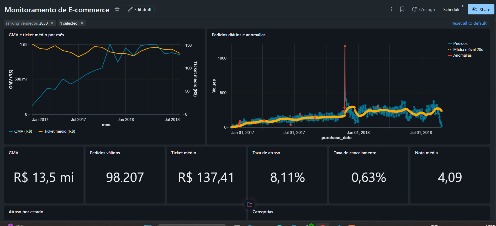

# Plataforma de Monitoramento de E-commerce

Pipeline de dados de ponta a ponta no **Databricks**, sobre ~100 mil pedidos reais de um marketplace brasileiro (Olist). Arquitetura Medallion (bronze, silver, gold), 15 regras de qualidade de dados, detecção de anomalias com alertas e dashboard operacional, orquestrados por um Workflow.



## Problema

Times de operação de e-commerce precisam saber, todos os dias, se vendas, entregas e avaliações estão dentro do esperado, e se os dados que alimentam os relatórios são confiáveis. Este projeto simula esse cenário: ingere, trata, valida, monitora e avisa quando algo foge do padrão.

## Resultados

| KPI | Valor |
|---|---|
| GMV (vendas válidas, sem frete) | R$ 13.494.400,74 |
| Pedidos válidos | 98.207 |
| Ticket médio | R$ 137,41 |
| Taxa de atraso na entrega | 8,11% |
| Taxa de cancelamento | 0,63% |
| Nota média das avaliações | 4,09 |

**Achados:**
- A **Black Friday de 2017** (24/11) foi detectada automaticamente: mais de 1.000 pedidos em um dia, muito acima da média móvel de 28 dias.
- Mercado pulverizado: os 10 maiores vendedores respondem por 13,2% do GMV, os 100 maiores por 45,3% e os 500 maiores por 78,4%.
- `health_beauty`, `watches_gifts` e `bed_bath_table` lideram em GMV. `furniture_decor` e `bed_bath_table` têm as maiores taxas de notas 1 e 2 entre as 10 maiores categorias.
- A taxa de atraso varia bastante por estado, chegando a cerca de 20% no Maranhão.

## Arquitetura

```
CSVs Olist ──► BRONZE ──► SILVER ──► GOLD ──► Dashboard (AI/BI)
               (bruto)    (limpo)    (KPIs)
                  │          │         │
                  └──────► QUALIDADE (15 regras) ──► ALERTAS (anomalias + falhas)

Orquestração: Databricks Workflow com 5 tasks encadeadas
```

| Camada | Notebook | O que faz |
|---|---|---|
| Setup | `00_setup` | Cria schema e volume no Unity Catalog |
| Bronze | `01_bronze_ingestion` | CSV para Delta, sem alterar dados, com `_source_file` e `_ingested_at` |
| Silver | `02_silver_transformations` | Tipagem, deduplicação, padronização, colunas derivadas (prazo, atraso) |
| Gold | `03_gold_kpis` | Fato de pedidos, vendas diárias, SLA por estado, vendedores, categorias |
| Qualidade | `04_data_quality` | 15 regras com histórico em `quality_results` e portão de qualidade |
| Alertas | `05_alerts` | Z-score de volume, alertas em `alerts_log`, envio opcional por Telegram |

## Decisões técnicas

- **`try_cast` na silver:** valor inválido vira `NULL` em vez de derrubar o pipeline, e a camada de qualidade mede esses nulos.
- **Deduplicação por chave de negócio:** em avaliações a chave é `(review_id, order_id)`, porque o mesmo `review_id` aparece em pedidos diferentes.
- **Geolocalização reduzida** de ~1 milhão de linhas para uma por prefixo de CEP (coordenada média).
- **Definições de negócio explícitas:** GMV = soma do preço dos itens de vendas válidas (status diferente de `canceled` e `unavailable`), sem frete. Taxa de atraso = entregues após a data estimada sobre pedidos com data de entrega.
- **Anomalias:** z-score contra a média e o desvio dos 28 dias anteriores, em calendário contínuo. A série usa só o período estável da base (2017-01-01 a 2018-08-29); 2016 e o fim de 2018 têm cobertura parcial e gerariam falsos alarmes.
- **Operação diária simulada:** como o Olist é uma base fechada, o notebook de alertas usa um relógio de simulação (`pipeline_state`) que avança um dia por execução. A Black Friday cai na 5ª execução.
- **Portão de qualidade:** falha crítica faz a task falhar, mas a task de alertas roda mesmo assim (`Run if: All done`) para avisar.

## Qualidade de dados

15 regras em 5 grupos (pedidos, itens e pagamentos, avaliações, integridade referencial, atualização), cada uma com severidade (`critical` ou `warning`) e limite de tolerância. Cada execução fica gravada em `quality_results`.

> Resultado da última execução: _preencher com a contagem de PASS/FAIL e, se houver FAIL, a causa investigada._

## Estrutura do repositório

```
notebooks/   00_setup ... 05_alerts (formato .py do Databricks)
sql/         dashboard_queries.sql (datasets do dashboard)
dashboard/   exportação .lvdash.json
workflows/   definição do job (YAML)
docs/        prints e diagramas
```

## Como reproduzir

1. Crie uma conta na [Databricks Free Edition](https://www.databricks.com/learn/free-edition) e conecte este repositório como Git folder.
2. Baixe o dataset [Olist Brazilian E-Commerce](https://www.kaggle.com/datasets/olistbr/brazilian-ecommerce) no Kaggle.
3. Rode `00_setup` e envie os 9 CSVs para o volume `workspace.varejo.raw`.
4. Rode os notebooks em ordem (`01` a `05`) ou crie o Workflow descrito em `workflows/`.
5. Crie o dashboard com as queries de `sql/dashboard_queries.sql`.

## Limitações e próximos passos

- A base é estática (2016 a 2018); a carga incremental é simulada.
- Envio de alertas por Telegram depende de acesso de rede e secrets, que variam na Free Edition.
- Próximos passos: testes unitários em `src/`, ingestão incremental real com Auto Loader, cruzamento com IPCA e Selic (Banco Central).

## Autor

**Johnatan Flores** · Dados e Operações · [GitHub](https://github.com/johnatantech) · [LinkedIn](https://www.linkedin.com/in/johnatan-flores-67595a221)
